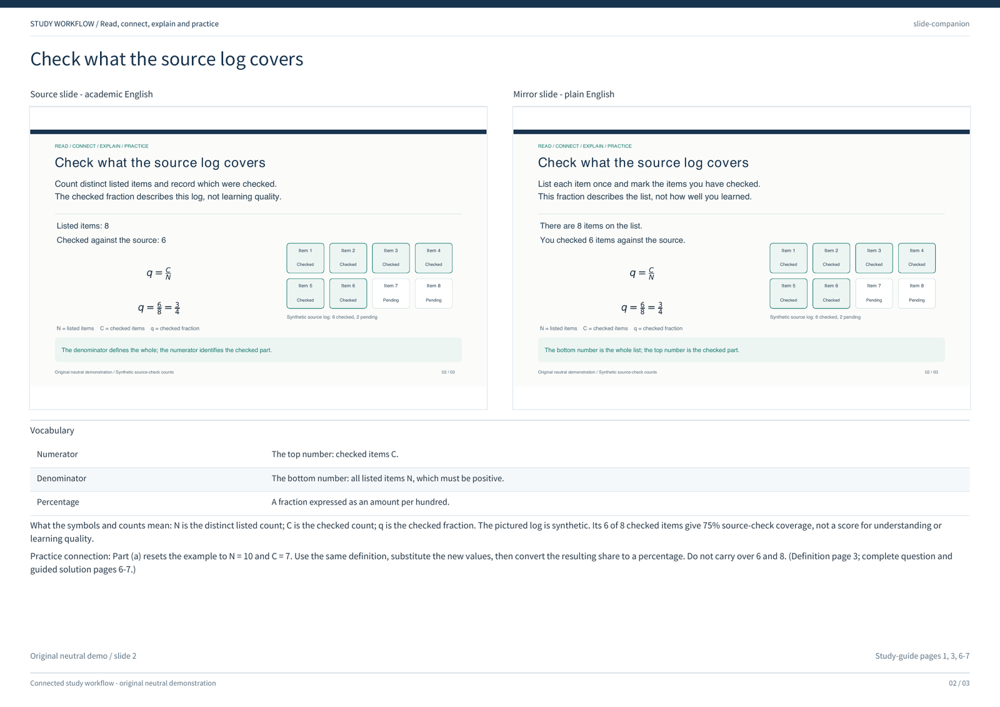
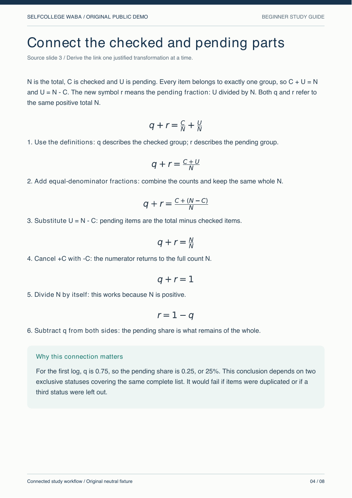
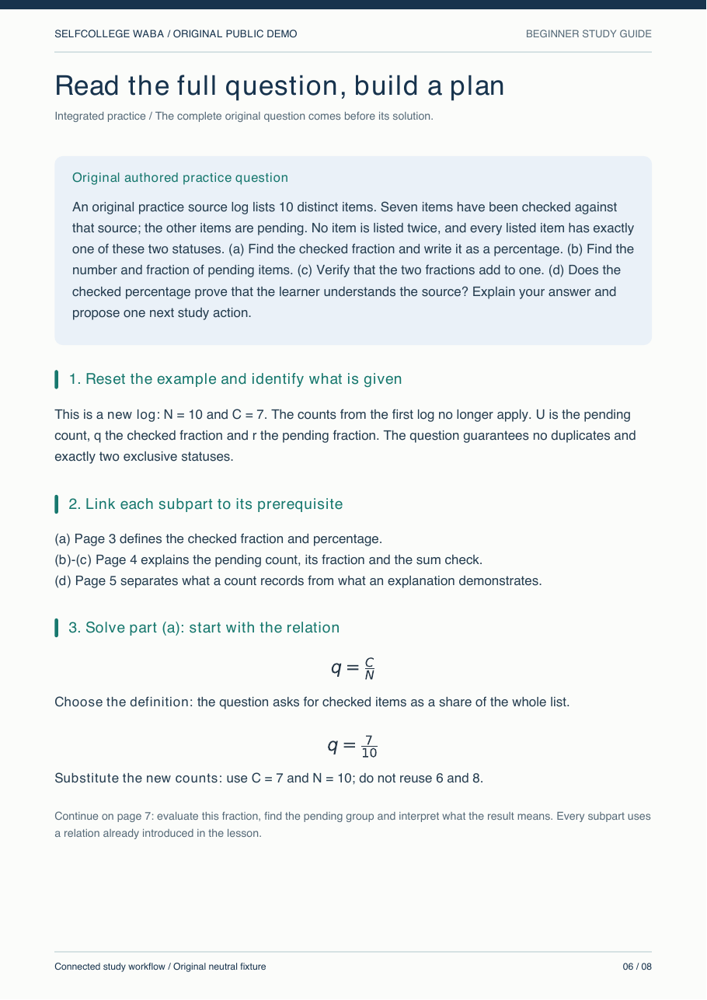

# Original neutral study example

This public example demonstrates a connected study workflow: read the complete
source, connect consecutive ideas, explain the reasoning, and use it in practice.
Its invented source log provides a small mathematical example: checked items as
a fraction of listed items. The fraction describes recorded source-check coverage;
it is not a score for mastery, understanding, teaching quality or learning outcomes.

All slides, questions, text and illustrations were independently authored for this
repository. The example uses no real course, institution, lecturer, student record,
classroom recording, assignment or private source material. It presents generic
study actions that can be adapted to arguments, procedures, code and calculations.

The two decks deliberately use **academic English and plain English** so every
public demonstration remains English. This shows the same layout contract used
for translation: titles, text origins, workflow boxes, ledger cells, fractions and
other visual elements share their geometry. The mirror changes wording; added
teaching material appears only in the band below both panels. It is a same-language
adaptation example, not evidence of a cross-language translation. Real language
pairs require supported fonts, readable text and translation review.

| File | Purpose |
| --- | --- |
| [source-slides.pdf](source-slides.pdf) | Three original neutral source slides in academic English. |
| [translated-slides.pdf](translated-slides.pdf) | The corresponding plain-English mirror with the same slide geometry. |
| [slide-companion.pdf](slide-companion.pdf) | Equal source and mirror viewports, followed by a full-width annotation band. |
| [beginner-study-guide.pdf](beginner-study-guide.pdf) | Eight connected pages: workflow, foundations, nearby symbol definitions, justified fraction steps, complete practice and interpretation. |
| [demo-spec.json](demo-spec.json) | Portable companion configuration, vocabulary, bottom notes and accurate guide-page references. |
| [validation.json](validation.json) | Actual page counts, authorship, metadata treatment and visual review status. |

The guide follows the three source slides in order. It explains the workflow, then
defines the checked fraction and derives its relationship to the pending fraction.
The complete original practice question, all conditions and all four subparts
appear on page 6; pages 6-7 solve them using the preceding knowledge blocks. Page 8
compares two fresh synthetic logs and explains why a count and a fraction answer
different questions. Short cross-disciplinary examples on page 5 connect the
workflow to arguments, procedures, programming and calculations.







To rebuild the files, install the repository's requirements and Poppler, then run:

```bash
python scripts/build_examples.py
```

The builder stages and renders every PDF before replacing the maintained bundle.
It puts the complete visual review set in `tmp/example-qa/`, outside the published
package. Fractions use horizontal numerator/denominator bars and vector glyphs.
Public PDF metadata uses only the product name and fixed UTC dates. Human review
is still required before publishing a regenerated output: successful rendering
and equal drawing coordinates alone do not establish teaching quality or content
fidelity. A fresh build resets the recorded review status to pending.
